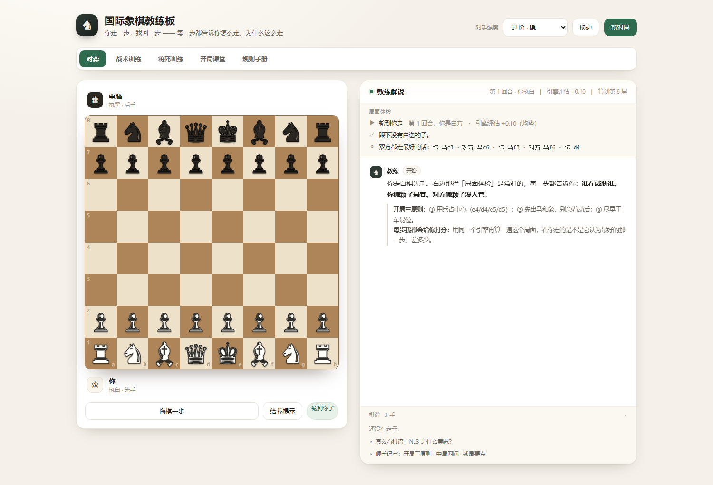
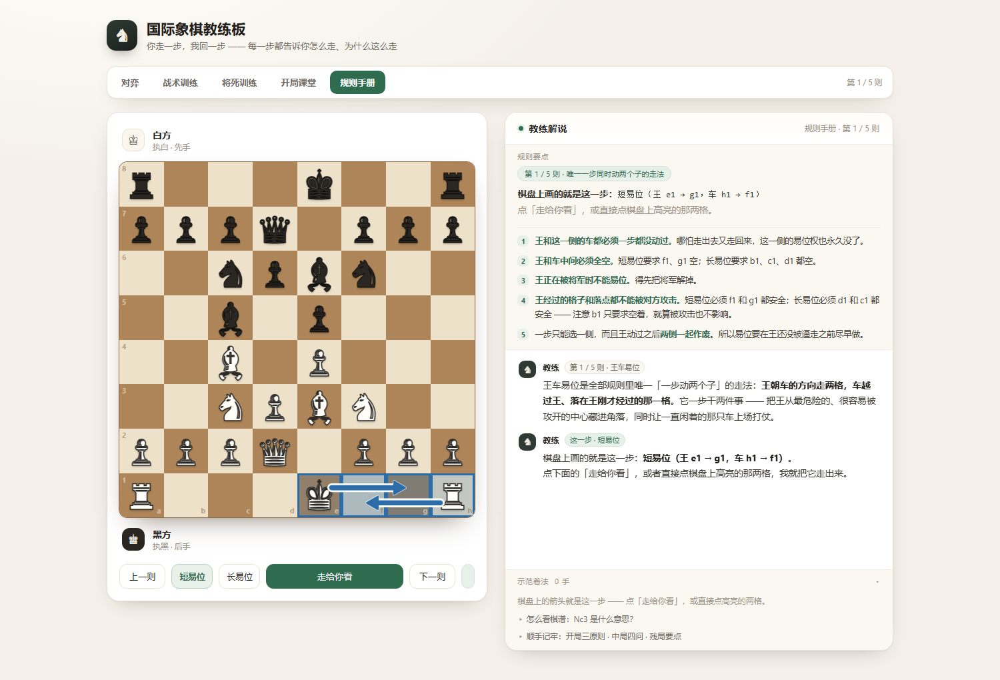
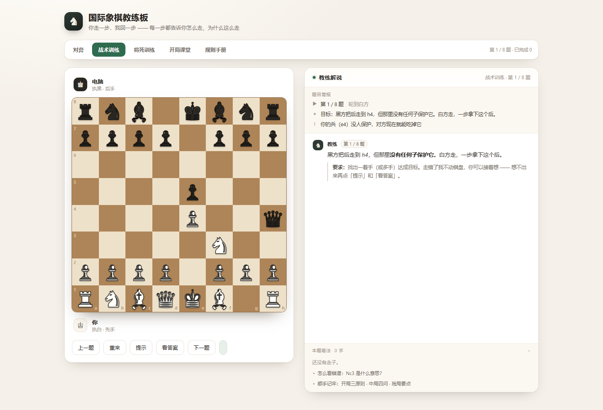

# ♞ 国际象棋教练板

**在线直接玩 → <https://haaaae1.github.io/chess-coach/>**

一个会「边下边讲」的国际象棋教练：跟它对弈，每一步它都告诉你**为什么**这么走、你刚才那步好在哪 / 亏在哪。除了对弈，还带战术训练、将死训练、开局课堂和规则手册。

整个东西是**一个 HTML 文件、零依赖、零构建**。没有 npm、没有框架、没有服务器，下载下来双击就能用，也可以直接挂在 GitHub Pages 上。



---

## 和普通的在线象棋有什么不一样

大多数在线棋盘只负责「让你走子」。这个的重点是**讲解**：

- **每一步都有复盘**。AI 走完会解释它为什么这么走（抢中心、保子、出子、将军、避开陷阱……），你走完它会点评你这步的作用和风险。
- **走之前先提醒你**。右栏一直显示「局面体检」：有没有白白送掉的子、对方有没有露出破绽、子力差多少、引擎评估是多少。
- **「给我提示」不是给答案**。它会说「我会走 马f3」，然后解释**为什么**，附带接下来几步可能的变化、另外两个也不错的选择，以及当前算到了第几层。
- **中文记谱**。全国内棋谱教程都写 `Nc3`，这里直接写 **`马c3`**。棋谱区下面附了一张中英对照表，把 `N` = Knight = 马 这类映射逐条列清楚。

---

## 五个模式

顶部一条切换：

| 模式 | 内容 |
|---|---|
| **对弈** | 跟引擎下整局。三档强度、可执白执黑、悔棋、提示、实时点评、局面体检。 |
| **战术训练** | 8 道战术题：白吃悬子、马分叉、车串击、后叉、升变吃子、牵制、换子价值、闪将。走错棋盘**原样不动**只给点评；同一位置连错三次才会问你要不要看答案。 |
| **将死训练** | 4 道一步杀（含学者杀、闷杀）+ 3 道两步杀（含莱加尔弃后）+ 2 道**自由演练**：后+王、车+王 杀光王。 |
| **开局课堂** | 6 节：占中心、出子顺序、王车易位、西班牙开局、西西里防御、后翼弃兵。每步一句白话，每节 3–4 条要点常驻右栏。 |
| **规则手册** | 5 则特殊规则：王车易位、吃过路兵、兵升变、逼和、另外三种和棋。每则用**一个真实局面 + 箭头提示走法**，点一下才真的走，不是静态文字。 |

**规则手册**尤其值得看一下。特殊规则光看文字基本学不会，所以每一则都是「棋盘停在走之前 + 箭头标出谁走到哪」，点「走给你看」棋盘才动。王车易位一步动两个子，所以画两支箭头。





### 残局演练会还手

后+王、车+王 这两道演练题不给你固定答案。黑王会**主动逃跑**去找更宽敞的地方，每步点评「笼子是收紧了还是松了」「它离边线近了没有」。如果你走成**逼和**、或者把后/车送到黑王嘴边，它会**把棋盘退回去**并讲正确做法——这是这两种残局里最容易输掉的两种方式，练的就是怎么避开。

---

## 引擎

引擎是从零手写的，没有用任何现成库。

**搜索**
- Negamax + alpha-beta，**迭代加深**（`analyze` 里 d=1 往上加，时间不够就退回上一层的结果）
- **置换表**：Zobrist 哈希（hi/lo 双 `Int32Array` 手写，不用 BigInt），存深度 + 边界标志 + 分值 + 最佳着法，杀棋分按 ply 修正
- **静态搜索**（quiescence）：叶子节点继续只吃子，避免「地平线效应」看漏换子
- **空着剪枝**（null-move，R=2/3，仅在非被将、depth≥3、有重子时启用）
- **LMR**：靠后的安静着法先减宽搜，变好了再全窗口重搜
- **杀手着法 + 历史启发**，配合 MVV-LVA 的着法排序
- **惰性合法性校验**：先走再看王安不安全，比「先把所有着法都筛一遍」快得多
- 严格限时，随时可中断（`tick()` / `ABORT`）

**评估**
- 子力价值 + 棋子位置表
- 兵型：叠兵、孤兵、通路兵（按列扫描）
- 王的处理**分阶段**：中局看安全，残局（非兵子力 < 1800）看往中心靠
- 双象加成

**难度**
同一套搜索，三档只差「给多少时间」和「允许多大程度的不精确」：

| 档位 | 深度上限 | 每步限时 | 换手概率 | 允许分差 | 候选池 |
|---|---|---|---|---|---|
| 入门 | 2 | 140ms | 50% | 0.70 兵 | 前 3 名 |
| 进阶 | 6 | 340ms | 30% | 0.22 兵 | 前 3 名 |
| 较强 | 24 | 1100ms | 15% | 0.12 兵 | 前 3 名 |

「换手」是指：以一定概率在**几乎等价**（分差在 slack 以内）的前几名里换一个走。所以同一个局面不会每次都给同一手，但也不会为了变化而走出坏棋。

> 一个坑：候选池大小由 `top` 决定。如果 `top:1`，池子里只有一步，`gamble` 调多大都换不掉——所以 `top` 必须 ≥ 2。

**开局**
前几步走一个小型开局库（10 个局面），让开局像人下的、而且每步都能配上教学点。库只覆盖到 3 个完整回合左右，之后完全交给搜索。

---

## 快速开始

**在线玩**：<https://haaaae1.github.io/chess-coach/>

**本地玩**：下载 `index.html`，双击。就这样。

**想自己起个服务**（其实不需要，`file://` 完全能跑）：

```bash
python -m http.server 8000
# 然后打开 http://localhost:8000
```

**部署到自己的 Pages**：fork 之后在仓库 Settings → Pages 里选 `main` 分支 `/ (root)`，`index.html` 就是入口，不需要任何构建步骤。

---

## 项目结构

```
chess-coach/
├── index.html                  # 全部内容：样式 + 引擎 + 界面，单文件
└── tests/
    ├── engine.test.js          # perft、搜索、评估
    ├── puzzles.test.js         # 题库合法性（FEN、答案、净收益、将死步数）
    ├── coach.test.js           # 教学层：讲解文案、体检、提示、悔棋、记谱
    ├── interaction.test.js     # 真的往棋格上派发点击事件，测交互流程
    └── difficulty.test.js      # 三档强度的选步分布（统计验证）
```

`index.html` 内部分成两段，用 `<script id="core">` 和 `<script id="ui">` 隔开：

- **`core`** —— 纯规则引擎，不碰 DOM。棋盘表示、着法生成、Zobrist、搜索、评估、题库数据、开局库。这段可以单独 `new Function()` 出来在 Node 里跑。
- **`ui`** —— 渲染、教练解说文案、五个模式的流程、交互。

这个切分就是为了能测试：三套回归脚本都把 `core` 抽出来在 Node 里直接跑，不需要浏览器。

---

## 测试

**需要 Node（只用于跑测试，玩不需要）。** 不装任何依赖：

```bash
node tests/engine.test.js
node tests/puzzles.test.js
node tests/coach.test.js
node tests/interaction.test.js
node tests/difficulty.test.js
```

**engine** —— 从起始局面算 perft 到第 4 层，跟已知答案逐个核对（`20 / 400 / 8902 / 197281`）；外加杀棋局面、战术局面、速度基准、自对弈稳定性。

**puzzles** —— 题库不是靠手写自信交付的。这个脚本把每一道题的 FEN 拉起来验证：王的数量、兵不在底排、非走子方不被将、首着真的存在、答案线全程合法、**将死题宣称的步数 == 实际强制将死步数**、战术题**净收益 ≥ 2 兵**、课程主线是完整回合（偶数步）。写这套脚本的过程里，一开始 7 道手写题有 5 道被它挑出实质缺陷。

**coach** —— 用 DOM 桩加载 `core + ui`，检查讲解文案没有套话残留、中文记谱逐条规则正确（`Nc3` → `马c3`、`Bxf7+` → `象×f7将军`、`bxa8=Q+` → `b×a8升后将军`、同种子消歧 `Ncd5` → `马cd5`）、**训练简报里不出现答案（不泄题）**。

**interaction** —— DOM 桩支持真的派发 `click` 事件，所以是**真的往棋格上点**而不是直接调内部函数。这样才能测出「两个处理器抢状态导致棋子点不动」这类 bug。残局演练部分会点完整条已验证的杀法（后+王、车+王）直到真的将死。

**difficulty** —— 随机策略必须用**统计**验证，不能读代码。同一局面跑 24 次看分布：较强档要能走出 ≥2 种应法；没走首选时的分差不得超出 slack。

---

## 已知限制

- **棋力**：三档里「较强」大概是个认真的业余水平，不是 Stockfish。它的价值在讲解，不在压倒你。
- **开局库很小**：只有 10 个局面、最深 3 个回合。之后全是搜索，所以中局重复感会比正式引擎强。
- **无网络、无持久化**：刷新即重置。没有云存档、没有账号、没有排行榜。
- **题库规模**：战术 8 题、将死 9 题、课堂 6 节。偏「入门到初级」，不是题海。

---

## 许可

没有附加许可证文件。想用、想改、想抄里面的着法生成或 Zobrist 实现，随便。
